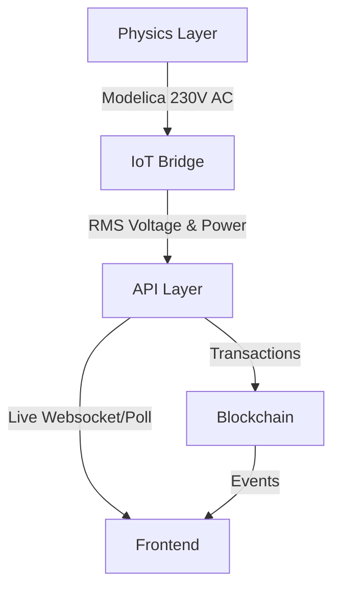

# ⚡ Joulet Digital Twin Platform

**Decentralized Energy Trading with Real-time Physics Simulation**

Joulet is a cutting-edge energy trading platform that bridges the gap between physical power grids and blockchain-based markets. It features a "Digital Twin" architecture where a real **Modelica** physics simulation drives the entire ecosystem, allowing for realistic testing of energy generation, grid instability (brownouts), and automated smart contract responses.

---

## 🏗 System Architecture

The system is composed of four integrated layers:



### 1. Physics Layer (Modelica)
- **File**: `iot-simulation/GridSystem.mo`
- **Engine**: OpenModelica
- **Simulation**: A realistic 230V AC Grid model (50Hz) with:
    - **Variable Load Profile**: Simulates changing household consumption.
    - **Noise Injection**: random voltage fluctuations.
    - **Brownout Injection**: Artificial instability events (Voltage < 210V).

### 2. IoT Bridge (Python)
- **File**: `iot-simulation/grid_bridge.py`
- **Tech**: OMPython
- **Role**: Connects the Modelica simulation to the digital world. It calculates **RMS Voltage** in real-time from the raw AC sine wave and pushes telemetry to the API.

### 3. API Layer (Flask)
- **File**: `iot-simulation/api_bridge.py`
- **Port**: 5001
- **Intelligence**: Monitors grid health.
    - **Normal Operation**: Aggregates energy production data.
    - **Emergency Mode**: If Voltage drops below **210V**, it triggers a **High-Priority Transaction** to the blockchain to secure pending energy credits before a potential blackout.

### 4. Blockchain Layer (Ethereum)
- **Contract**: `JouletToken (JLT)`
- **Role**: Decentralized ledger for energy verification ("Proof of Generation").

### 5. Visualization Layer (React)
- **Dashboard**: `client/`
- **Port**: 5173
- **Features**: Live "Grid Monitor" with real-time voltage gauge and incident logs.

---

## 🌟 Key Features

### ✅ Real-time Brownout Detection
The system monitors the grid 10 times per second. If the RMS voltage dips below the safety threshold (210V), the system identifies a "Brownout" event.

### ✅ Automated Blockchain Response
Upon detecting instability, the IoT layer automatically "flushes" any accumulated energy credits to the blockchain. This ensures that energy producers are credited for their generation even if the grid goes down moments later.

### ✅ Visual "Digital Twin" Dashboard
The frontend provides a dedicated **Grid Monitor** view that mirrors the state of the physics simulation, showing:
- Live Voltage Gauge (Green/Red)
- Real-time Sine Wave visualization
- Historical Log of grid anomalies

---

## 🚀 Getting Started

### Prerequisites
1.  **Node.js** & **Python 3.10+**
2.  **OpenModelica** (Required for the physics simulation)
    -   *Mac*: `brew install openmodelica`
    -   *Windows*: Download installer from openmodelica.org

### Installation
```bash
# 1. Install dependencies
cd joulet-project
chmod +x start.sh

# 2. Start the full stack (Blockchain, API, Grid Sim, Frontend)
./start.sh
# Select Option 1 ("Start Full Stack")
```

### Manual Startup (for debugging)
If you prefer running components in separate terminals:

**Terminal 1: Blockchain**
```bash
cd blockchain
npx hardhat node
# (In new tab) Deploy contract:
npx hardhat run scripts/deploy.js --network localhost
```

**Terminal 2: API Bridge**
```bash
cd iot-simulation
source venv/bin/activate
pip install -r requirements.txt
python api_bridge.py
```

**Terminal 3: Grid Simulation**
```bash
cd iot-simulation
source venv/bin/activate
python grid_bridge.py
```

**Terminal 4: Frontend**
```bash
cd client
npm run dev
```

---

## 🔧 Configuration

**`iot-simulation/.env`**
```ini
RPC_URL=http://127.0.0.1:8545
API_PORT=5001
diff_window_sec=60
```

**`client/.env`**
```ini
VITE_API_URL=http://localhost:5001
```

---

## 🧪 Testing the Simulation

1.  Open the Dashboard at **http://localhost:5173**.
2.  Navigate to **Grid Monitor** sidebar item.
3.  Watch the voltage gauge. It should hover around **230V**.
4.  Wait for a few seconds. The mock simulation will randomly trigger a dip to **~200V**.
5.  Observe the UI flash **RED** and a new entry appear in the Incident Log.
6.  Check the API logs to see the "High Priority" transaction being dispatched.

---

**License**: MIT
